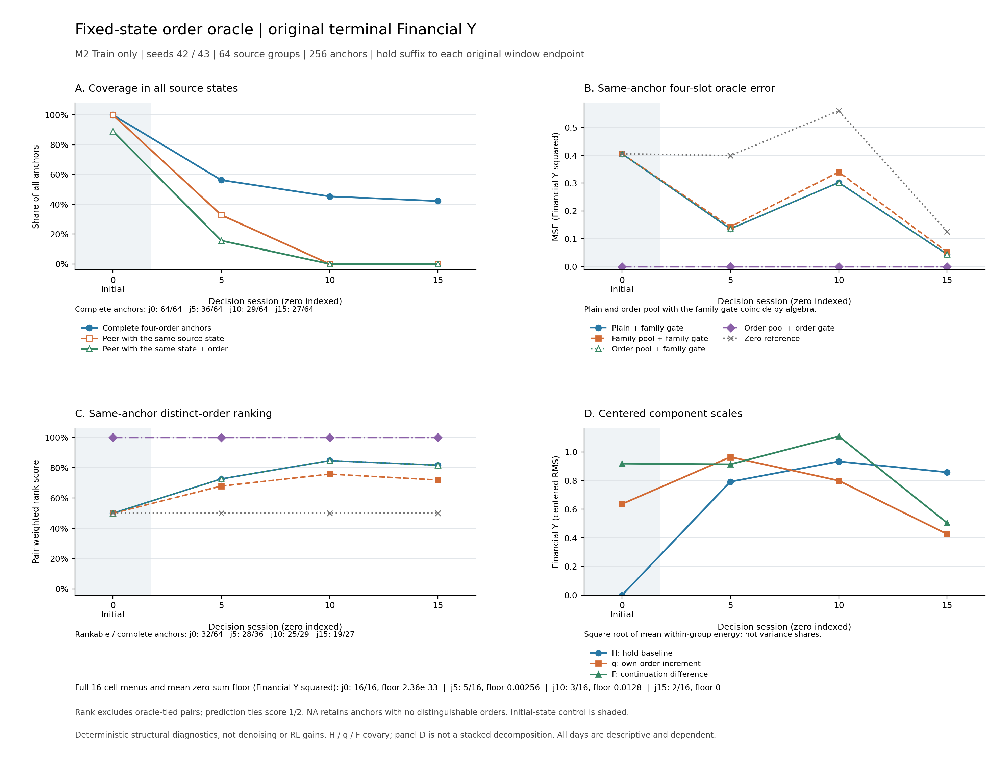

# M2 多状态具体订单功劳验证结果

2026-10-17，SGT（UTC+8）。本轮 CPU 回放于 21:17:44 完成，采集耗时约 6 分 8 秒；64 条历史轨迹精确复现，256 个原对角订单全部合法并完整结束。结果支持先解决**同状态取样、具体订单分歧 gate 和 credit 目标**，暂不扩大 RL。仅细化池化键，不能解决后期状态同伴稀缺，也不能绕过原 gate 的置零。

## 固定样本与目标

[执行前方案](2026-10-17_M2_STATE_ORDER_ORACLE_PLAN.md)、采集器、读数脚本及实际输入在回放前绑定于[合同](../runs/m2-state-order-oracle-20261017-v1/contract.json)。只使用已完成四轮对照中 M2、seed42/43 的 Train 轨迹：每轮固定两窗，共 8 窗；每窗选择零起算决策 session `j=0,5,10,15`，每组保留原四兄弟槽。共 64 个 source group、256 个 anchor 状态实例、1024 个订单移植 cell，另设每个状态的 hold 参考分支。

在状态 i 尝试本组订单 j 后，固定 hold 至原 21-session 窗口终点，得到终局金融 `Q_ij`；从同状态直接 hold 得到 `H_i`，动作相对 hold 的贡献为 `q_ij=Q_ij−H_i`。完整 prefix 保留历史权益、换手、回撤以及当前 session 之前的所有请求。实际环境判断移植合法性；非法 cell 保留报错、Y/q 记 NA，不修订单、不补 hold、不删总分母。合法 skip 与零成交保留。

这是确定性、固定后续规则的反事实诊断，不是模型重新从这些状态采样，也不是原策略继续行动时的优势估计。MSE 单位为**原金融 Y 的平方单位**。全程零模型请求、零优化器更新，不使用 GPU、不读取正式 Valid / Final OOS。[采集收据](../runs/m2-state-order-oracle-20261017-v1/collection_completion.json)记录实际计数。

## 状态与合法菜单覆盖不足

以下每个 j 都有 64 个 anchor、16 个 source group；“同状态同伴”仅在各自原四兄弟内按完整经济风险状态匹配，不以日期相同代替状态相同。

| 决策 session j | 合法 cell / 256 | 四订单全合法的 anchor / 64 | 全 16 cell 合法的组 / 16 | 有同状态同伴的 anchor / 64 | 有同状态同订单同伴的 anchor / 64 |
|---|---:|---:|---:|---:|---:|
| 0，共同初态 | 256 | 64 | 16 | 64 | 57 |
| 5 | 219 | 36 | 5 | 21 | 10 |
| 10 | 211 | 29 | 3 | 0 | 0 |
| 15 | 192 | 27 | 2 | 0 | 0 |
| 合计 | 878 / 1024 | 156 / 256 | 26 / 64 | 85 / 256 | 67 / 256 |

离开初态后的 192 个状态中，只有 **21 个（10.9%）**有同状态同伴，只有 **10 个（5.2%）**还有相同订单同伴。精确 state/order 分组在其余状态退化为 singleton；当前四兄弟整条轨迹逐步分叉，不能靠换分组键获得同状态重复样本。

146 个非法移植均发生在后期：70 个买入目标不高于当前权重，76 个卖出目标不低于当前权重。原订单在自己的状态全部合法，但转移到兄弟组合后不一定仍是可行动作。这是菜单支持问题，不是原恢复验收再次失败。后期只有 92/192 个状态支持完整四槽比较，只有 10/48 个组支持完整 4×4 矩阵；不能从成功子集外推全部状态。

878 个合法 cell 中，56 个为 hold，822 个为买卖请求；买卖请求中 790 个实际成交并有正成本，32 个为合法 next-open skip，全部保留。上述是逻辑 cell 计数；32 个 skip 对应 17 个实际去重分支，不当作独立执行次数。含 hold 参考后共执行 624 个不同分支，完整计数见[完整性审计](../runs/m2-state-order-oracle-20261017-v1/integrity_audit.json)。

## 原 family gate 会消去真实订单差异

64 个 source group 中，27 个组的原动作族 gate 关闭，但具体订单 gate 可以打开。156 个四订单全合法 anchor 中，104 个存在真实效果不同的订单；其中 **67/104 个被原 family gate 整行置零**，初态占 32 个，后期占 35 个。

主分析目标是同一 anchor 四订单的 `q_ij−mean_j(q_ij)`。以下保留原四槽及重复权重，MSE 按全部 624 个槽汇总；排序只比较 oracle 不同的槽对，共 418 对，预测 tie 计 0.5。槽、同组 anchor 和同窗日期均非独立样本。

| 算子 | MSE | 槽对排序一致率 |
|---|---:|---:|
| 全零参照 | 0.38443 | 50.00% |
| plain，保留原 family gate | 0.26147 | 70.22% |
| family pool，保留原 gate | 0.27165 | 65.43% |
| 具体订单 pool，保留原 gate | 0.26147 | 70.22% |
| 具体订单 pool + 具体订单 gate | 约 0 | 100% |
| 不设 gate 的 plain | 约 0 | 100% |

最后两行是确定性结果的代数恒等：同状态同订单的结果相同，同一 anchor 四个 fixed-hold Q_ij 中心化已经等于目标。它们**不证明池化降噪，也不证明改 gate 后 RL 收益会上升**。只细化订单 pool 而保留原 gate，恰与 gated plain 相同。

只看后期 92 个完整 anchor，plain 与 family pool 的 MSE 分别为 0.16128、0.17854；306 个非平局槽对上的一致率分别为 77.61%、71.08%。本批排序损失全部表现为预测 tie 增多，plain 有 249/418 对预测 tie，family pool 有 289/418 对；未观察到预测反序。这仍会抹掉可区分订单的信号。

另存去重订单统计：同一 156 个四订单完整 anchor 的非平局不同订单对共有 196 对，plain / family pool 的 pair-weighted 一致率为 73.72% / 67.60%。它与上表四槽口径不同，不混用分母，也不把去重后的 pair 当作独立样本。

## 原终分同时包含状态与后续行为差异

对原对角订单定义 `F_i=Y_i−Q_ii`，其中 Y 为原历史终局分数。精确关系为 `Y_i=H_i+q_ii+F_i`。F 包含原策略后续行为与固定 hold 后续的差异，不是已识别的独立噪声。下表为组内中心化后各分量的 RMS，单位仍为金融 Y：

| j | 状态 hold 基线 H | 对角动作贡献 q | 后续差异 F |
|---|---:|---:|---:|
| 0 | 0.000 | 0.637 | 0.919 |
| 5 | 0.792 | 0.965 | 0.914 |
| 10 | 0.934 | 0.800 | 1.110 |
| 15 | 0.858 | 0.427 | 0.505 |

后期 H、q、F 均有可观差异，且交叉协方差较大，不能把三者平方能量直接加总为“噪声占比”。`center(q_diagonal)` 也是不同状态的组件向量，不是同一状态的动作优势。

例如，以该组件向量作参照，原 Y 输入下 plain / family pool / state+order pool 的 MSE 为 0.83957 / 0.62918 / 1.00605，全零参照为 0.53964。这里更细的 state+order 键没有自动改善一致性；这些值只说明对指定目标的组件匹配，不能当成同状态动作排序或原策略梯度偏差的证明。

读数分别保留原 Y、固定 hold 对角 Q、原 Y−H、固定 hold 对角 Q−H 四种输入。后两种使用未来 hold oracle，只作特权参照，本轮没有可部署或经留出验证的状态 baseline；减去 H 后原 Y 仍包含 F，也不保证每项目标的误差都会降低。

## 菜单相对贡献还存在表示边界

对四订单均合法的行，定义 `tau_i=Q_ii−mean_j(Q_ij)`；它相对于**本状态的四槽订单菜单**，与相对 hold 的 q 不同。仅在 16 个 cell 全合法的 source group 上比较完整四维 tau，不把缺失组重心化或拼成新组。

后期仅 10/48 个组满足该条件，其中 5 个 tau 全零，4 个 `mean_i(tau_i)` 非零。任何必须零和的四兄弟残差，对未中心化 tau 都至少有 `(mean_i(tau_i))²` 的 MSE；这 10 个组的平均下界为 0.00513，最大为 0.03843。这是固定 hold 菜单目标下的表示限制，支持面较窄，不是金融收益结论，也不能单凭此宣布原训练估计器有偏。

所有代数检查通过，最大绝对误差为 3.33e−15；[独立重算](../runs/m2-state-order-oracle-20261017-v1/independent_readout_audit.json)核对覆盖率、主面板及组件结果。没有 IID p 值或收益显著性检验。[完整读数](../runs/m2-state-order-oracle-20261017-v1/readout.json)同时保留按窗口、seed、日期分层、预测 tie、非零信号及缺失支持。

图中排序使用去重订单的 pair-weighted 口径，上文主表使用原四槽口径。[SVG](../runs/m2-state-order-oracle-20261017-v1/state_order_oracle_summary.svg)可导出。原始表：[算子指标](../runs/m2-state-order-oracle-20261017-v1/readout_metrics.csv)、[覆盖](../runs/m2-state-order-oracle-20261017-v1/readout_coverage.csv)、[组件代数](../runs/m2-state-order-oracle-20261017-v1/readout_algebra.csv)、[有支持的 tau 行](../runs/m2-state-order-oracle-20261017-v1/readout_matched_rows.csv)。

## 下一步先改变比较单位

下一轮应从**同一个完整 prefix 分支取样**，让候选面对相同现金、持仓、风险历史与观察，并先固定该状态下合法的具体订单菜单。先用 CPU 构造与回放验证支持和账务，再安排模型同状态取样；不要直接把旧兄弟不同状态的订单当成新状态的策略样本。

在启动新的学习实验前固定三项内容：

1. 明确要估计原策略后续条件下的 Q/advantage，还是固定 hold 后续的局部贡献；期限、后续规则及评判目标一致。
2. 分开对照具体订单 gate、订单 pool 和状态 baseline，并保留 ungated plain、全零参照及完整失败分母；固定 hold 确定性恒等不充当降噪证据。
3. 若学习状态 baseline，只用训练可见输入，按 episode 及重叠 horizon 分折、时间 purge，再在留出状态评估；未来 oracle H 不直接接入训练。

这轮已完成原定 CPU 验证。下一项同 prefix 取样与合法菜单实验尚未启动；离线尺度匹配、共同初始化小规模 RL 和新 seed / 新日期确认仍待后续安排。[复现入口与最终核验](../runs/m2-state-order-oracle-20261017-v1/README.md)。
