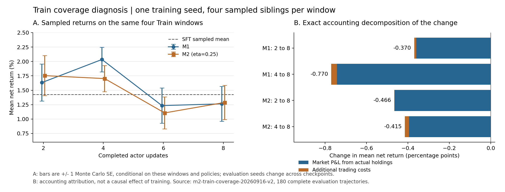

# 2026-09-17 实验结果备份

快照采集时间：**2026-09-17T21:03:21+08:00（新加坡 UTC+8）**。

这是用于 GitHub 讨论和追溯的精简结果快照。模型权重、剩余优化器、完整请求/响应轨迹、
原始市场数据及完整 `runs/` 仍在服务器原位置；本目录不构成可恢复训练的完整备份。
这里的 `runs/` 是少量复制结果，不能作为新的实验运行目录。

所有已完成结果按原实验、checkpoint 轮次、窗口及解码方式保留；没有重新合并 greedy/sample、
不同日期窗口或不同 SFT 起点。不同实验之间的收益不能脱离各自协议直接比较。
“完成”指执行/证据完备，不代表方法有效；冷启动 v2 的 FAIL 和 M2 落后读数均保留。

| 实验 | 阅读入口 | 机器证据 |
|---|---|---|
| 冷启动 v1 | [报告](docs/2026-09-13_M2_COLDSTART_REPORT.md) | [原 readout](runs/m2-coldstart-20260913/readout.json) |
| 冷启动 v2 | [报告](docs/2026-09-13_M2_COLDSTART_V2_REPORT.md) | [门禁和解码分组](runs/m2-coldstart-v2-20260913/gates_and_decode_summary.json) |
| 冷启动 v3 | [报告](docs/2026-09-14_M2_COLDSTART_V3_REPORT.md) | [门禁和解码分组](runs/m2-coldstart-v3-20260914/gates_and_decode_summary.json) |
| 共同 SFT 两轮 RL | [报告](docs/2026-09-14_M2_COMMON_SFT_SHORT_RL_REPORT.md) | [分臂/分轮摘要](runs/m2-common-sft-short-rl-20260914/readout_summary.json) |
| critic/η 训练调参 | [最终结果](runs/m2-training-tuning-20260914/FINAL_RESULTS.md) | [验收曲线](runs/m2-training-tuning-preparation-20260914/comparison_summary_evaluation_summary.csv)、[配对差](runs/m2-training-tuning-preparation-20260914/comparison_summary_paired_curves.csv) |
| 解码配置对照 | [最终结果](runs/m2-sampling-profile-eval-20260915/FINAL_RESULTS.md) | [分模型/解码 CSV](runs/m2-sampling-profile-eval-20260915/summary.csv) |
| 16 窗 Train coverage | [最终结果](runs/m2-train-coverage-20260916-v2/FINAL_RESULTS.md) | [分轮/解码 CSV](runs/m2-train-coverage-20260916-v2/summary.csv)、[完成验收](runs/m2-train-coverage-20260916-v2/completion_validation.json) |
| coverage 收益/学习信号诊断 | [报告](docs/2026-09-17_M2_TRAIN_COVERAGE_DIAGNOSTIC_REPORT.md) | [行为均值](runs/m2-train-coverage-diagnosis-20260917/behavior/group_means.csv)、[采样分析](runs/m2-train-coverage-diagnosis-20260917/sampling/sampling_analysis.json) |

## 尚未开始的新实验

共同拒单罚四轮实验在这个快照中是 **NOT STARTED / WAITING_FOR_GPU，0/164 条轨迹**。
[LIVE_STATUS 时间点副本](runs/m2-common-validity-penalty-20260917/LIVE_STATUS.md)和
[队列时间点副本](runs/m2-common-validity-penalty-20260917/gpu_queue_state.json)可能来自相邻刷新，
各自保留原时间戳。它们不会随服务器后续进展自动更新，也不是实验结果。

## 来源与校验

[manifest.json](manifest.json) 对每份输出记录大小与 SHA-256、仓库根目录下的原始相对路径、
原文件 SHA-256。报告、CSV、图片、身份与验收收据均逐字节复制；只有两份冷启动分组摘要和
一份短 RL 摘要是明确字段投影，不重新计算指标；投影规则逐项列在 manifest。
manifest 自身不做递归自哈希，其他全部文件都有输出哈希。

源报告保持原文与原相对链接；未纳入本精简备份的历史计划、完整诊断 JSON 或逐步轨迹，
仍需从原仓库/服务器路径读取。输入/模型哈希可以核对身份，不表示这些大文件已经上传。
可在服务器从仓库根目录运行
`python3 docs/results/2026-09-17-backup/_build_snapshot.py` 重建；如果新实验已经启动，
脚本会要求先更新“未开始”的快照说明。重建会改变快照采集时间；不会改写原实验文件。
